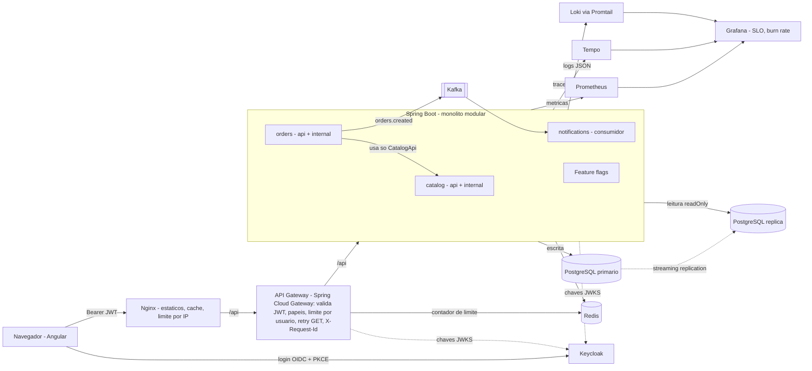

# Protótipo: loja modular (princípios estilo Google, escala de equipe)

> **Como executar tudo, em ordem:** [docs/PASSO-A-PASSO.md](docs/PASSO-A-PASSO.md)

Tudo o que foi citado na "arquitetura prática" está aqui, com o arquivo onde cada item vive.

## Arquitetura

O backend não é publicado no host: só o gateway (porta 8080) o alcança. O token é validado no gateway e de novo no backend (defesa em profundidade).

Fronteiras: `orders` só enxerga `catalog.api`; `notifications` só conhece o contrato JSON do tópico. O `ArchitectureTest` (ArchUnit) quebra o build se alguém violar.

## Mapa: o que foi citado, onde está e qual o status

Legenda: ✅ executado aqui · 🟡 escrito e validado só estaticamente (nunca rodou) · ⚪ parcial/representado · ❌ não incluído

| Item citado | Onde | Status |
|---|---|---|
| Login (Keycloak, OIDC + PKCE) | `docker-compose.yml`, `infra/keycloak/shop-realm.json` | 🟡 |
| Token no front | `frontend/src/app/auth/` | ✅ build + 10 testes Karma |
| Token no back | `backend/.../security/`, `application.yml` | 🟡 Java nunca compilado |
| Autorização por role | `SecurityConfig`, `SecurityTest` | 🟡 |
| Angular | `frontend/` | ✅ `ng build` + `ng test` |
| CDN | `frontend/nginx.conf` (cache longo, gzip) | ⚪ só os headers; não há CDN real |
| API Gateway | `gateway/` (Spring Cloud Gateway: JWT + papéis na borda, limite por usuário no Redis, retry de GET, `X-Request-Id`, trace), `k8s/base/gateway.yaml`, ADR 0004 | 🟡 Java nunca compilado |
| Monólito modular + fronteiras | `catalog/orders/notifications`, `ArchitectureTest` (ArchUnit) | 🟡 |
| Contratos OpenAPI (contract-first) | `api/openapi.yaml`, `ContractTest`, tipos gerados no front (CI barra drift) | ✅ front / 🟡 back |
| gRPC | — | ❌ escolhi OpenAPI/REST (ver ADR 0001) |
| PostgreSQL + réplica de leitura | `infra/postgres/`, `ReplicaRoutingConfig`, Flyway V1–V3 | 🟡 |
| Migração em Postgres real | `PostgresMigrationTest` (Testcontainers) | 🟡 pula sem Docker |
| Redis (cache) | `CatalogService` (`@Cacheable`) | 🟡 |
| Eventos assíncronos (Kafka) | `KafkaOrderEventRelay`, `OrderCreatedListener` (consumidor idempotente) | 🟡 |
| Outbox | `microservices/services/shop-common` (versão microsserviços); o monólito segue sem outbox (ADR 0002) | 🟡 |
| Microsserviços + Kafka (saga, outbox, inbox, DLT) | `microservices/services/`, ADR 0005 | ✅ sintaxe e contratos · 🟡 Java nunca compilado ou executado |
| Microfrontends Angular (Module Federation) | `microservices/web/` (shell + 3 remotos) | ✅ build e teste em Chromium |

| Kubernetes | `k8s/base` + `overlays/{staging,production}` | ✅ `kustomize build` dos dois overlays · 🟡 nunca aplicado |
| Elasticidade e alta disponibilidade (HPA, PDB, spread, parada limpa) | `k8s/base/{hpa,pdb,backend}.yaml`, `docs/kubernetes-elasticidade.md`, `scripts/elasticity-check.sh` | ✅ `kustomize build` · 🟡 nunca rodou em cluster |
| Escala dos nós (desligar máquinas ociosas) | `k8s/optional/karpenter-nodepool.yaml` (AWS, placeholders) | 🟡 opcional, depende da nuvem |
| Kubernetes gerenciado / Postgres/Kafka/Redis gerenciados | — | ❌ não provisionado; usar serviços da nuvem |
| OpenTelemetry → Tempo | `pom.xml`, `application.yml`, `tempo.yml` | 🟡 |
| Prometheus + Grafana + dashboard | `observability/` | 🟡 |
| Logs (Loki + Promtail) e link log→trace | `promtail.yml`, `datasources.yml` | 🟡 depende do nome do campo de trace nos logs ECS |
| Alertas (Alertmanager) | `observability/alertmanager.yml`, `alert-sink` no compose | 🟡 |
| PodMonitor (métricas no cluster) | `k8s/observability/podmonitor.yaml` | 🟡 exige Prometheus Operator |
| SonarQube | profile `quality`, job no `ci.yml` | 🟡 |
| Design doc + ADR | `docs/` | ✅ |
| Trunk-based, PR, CODEOWNERS | `pull_request_template.md`, `CODEOWNERS`, `scripts/protect-main.sh` | ⚪ proteção da branch é config do GitHub: rode o script |
| Feature flags | `FeatureFlags` | ⚪ por configuração, sem serviço de flags |
| Dependabot | `.github/dependabot.yml` | 🟡 |
| Pirâmide de testes | unit, HTTP/H2, ArchUnit, Testcontainers, Karma, Playwright | ✅ Karma · 🟡 demais |
| E2E (Playwright) | `e2e/` (6 testes, incl. login real no Keycloak) | 🟡 typecheck OK; nunca executado |
| CI | `.github/workflows/ci.yml` (backend, gateway, frontend, manifests, e2e) | ✅ actionlint |
| CD staging → produção | `release.yml`, `scripts/{deploy,smoke}.sh` | ✅ actionlint/shellcheck · 🟡 nunca rodou |
| Canário 5%→100% + rollback | `scripts/canary.sh` (falha fechada sem métricas) | ✅ shellcheck · 🟡 nunca rodou |
| SLO e orçamento de erro | `docs/slo.md`, `observability/rules/slo.yml` | 🟡 |
| Postmortem sem culpados | `docs/postmortem-template.md` | ✅ |

Ligar a flag de desconto (10% a partir de 10 unidades): `FEATURES_BULK_DISCOUNT=true`.

## Status de verificação (leia antes de usar)

Foi gerado num ambiente sem acesso ao Maven Central nem a um daemon Docker.

- **Executado de verdade:** `ng build` e `ng test` (10 testes, Chromium headless, todos passando); `tsc` do pacote e2e (6 testes listados); `kustomize build` dos overlays staging e production; `actionlint` nos workflows; `shellcheck` nos scripts; `docker compose config`; parse de todos os YAML/JSON.
- **Escrito mas nunca compilado/executado:** todo o Java — backend e gateway (backend hoje: 26 métodos de teste JUnit + 3 regras ArchUnit; gateway: 9 testes), os testes Playwright, `docker compose up`, importação do realm e login no Keycloak, Kafka, replicação, Tempo/Loki, alertas, aplicação no Kubernetes, `canary.sh`. Comece por `cd backend && mvn verify`; ajustes pequenos são esperados. Pontos mais prováveis: realm do Keycloak e o `iss` do token dentro do Docker.
- **Limitações assumidas:** CDN só representada por headers; sem gRPC; sem outbox (evento pode se perder se o Kafka cair); flags por configuração; infraestrutura gerenciada não provisionada; proteção da `main` e aprovação manual do ambiente `production` são configurações do GitHub (veja `scripts/protect-main.sh`).
