# Arquitetura do Thunder

Mapa de todos os módulos, pacotes e classes, do desenho macro (quem fala com quem) ao micro (o que cada classe faz).
Os diagramas são Mermaid e aparecem desenhados no GitHub e no VS Code. A versão em página única, com os diagramas já desenhados e sem depender de rede, é `docs/ARQUITETURA.html`.

> **Escopo.** "Todos os projetos" aqui são os módulos do repositório `thunder`: o monólito (`backend/`, `gateway/`, `frontend/`), a versão em microsserviços (`microservices/services`, `microservices/web`), os testes de ponta a ponta (`e2e/`) e a infraestrutura (`k8s/`, `microservices/k8s`, `infra/`, `observability/`, `scripts/`, `.github/`).
> **Origem.** Escrito a partir do código da `main` (25 classes Java em `backend`, 4 em `gateway`, 10 em `shop-contracts`, 16 em `shop-common`, 22 em `catalog-service`, 17 em `order-service`, 6 em `notification-service`, mais 4 do protótipo `order-workflow`; 7 arquivos TypeScript no `frontend` e 35 em `microservices/web`). Nomes de classe, rotas, tópicos e tabelas foram conferidos contra o código. Onde algo não foi executado em ambiente real, o texto diz isso (seção 9).

## Sumário
1. [Desenho macro](#1-desenho-macro)
2. [Features e onde vivem](#2-features-e-onde-vivem)
3. [Monólito: `backend` e `gateway`](#3-monólito-backend-e-gateway) (micro: camadas, fluxo do pedido, pacotes, dados)
4. [Microsserviços](#4-microsserviços) (micro: bibliotecas, um serviço por dentro, saga, estados, tópicos, dados)
5. [Frontends](#5-frontends)
6. [Implantação e segurança](#6-implantação-e-segurança)
7. [Automação: CI, release e testes](#7-automação-ci-release-e-testes)
8. [Terceiros](#8-terceiros)
9. [Limites deste documento](#9-limites-deste-documento)

---

## 1. Desenho macro

### 1.1 Contexto: quem usa e com quem o Thunder conversa

O Thunder é uma loja com duas formas de implantar o mesmo domínio (produtos, pedidos, notificações). O gateway é o mesmo código nas duas.

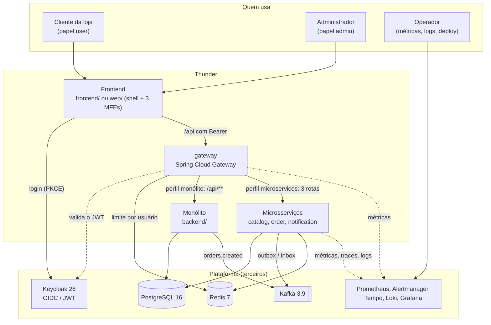

### 1.2 Contêineres e implantação

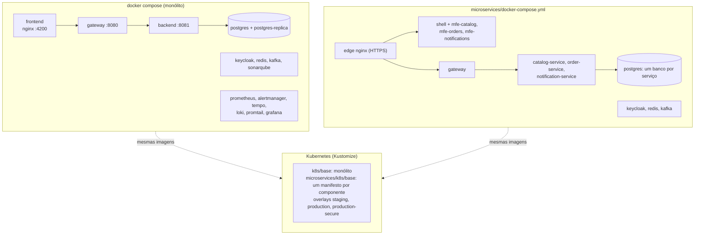

Há ainda `microservices/docker-compose.vm.yml`: o mesmo compose dos microsserviços numa VM, com Caddy na frente emitindo certificado Let's Encrypt para o domínio e para `auth.<domínio>` (gerado por `infra/vm/render.sh`).

### 1.3 O caminho de um pedido (visão de pássaro)

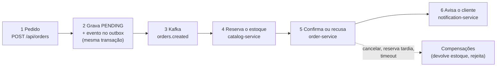

No monólito o caminho é mais curto: o `OrderService` cria o pedido, o `KafkaOrderEventRelay` publica `orders.created` depois do commit e o módulo `notifications` guarda a notificação.

---

## 2. Features e onde vivem

| Feature | Monólito | Microsserviços | Front |
|---|---|---|---|
| Listar e buscar produtos | `ProductController`, `CatalogService` | `ProductController`, `CatalogService`, `ProductCache`, `ProductSpecs` | `products.page.ts` (`mfe-catalog`), `app.ts` |
| CRUD de produtos e categorias (admin) | — (só leitura; dados vêm das migrações) | `ProductController` (`/api/admin/products`), `CategoryController`, `CategoryService` | `products.page.ts`, `categories.page.ts` |
| Fazer, listar e cancelar pedido | `OrderService`, `OrderController` (sem cancelar) | `OrderService`, `OrderController` | `orders.page.ts`, `orders.api.ts` |
| Desconto por volume (feature flag) | `OrderService`, `FeatureFlags`, `BulkDiscountFlagTest` | — | — |
| Reserva de estoque e devolução | — | `StockService`, `StockReservation` | — |
| Saga do pedido e compensações | — | `OrderSaga`, `SagaListeners`, `PendingOrderReaper` | — |
| Preço local copiado do catálogo | — | `ProductSnapshot`, `CatalogAnnouncer` | — |
| Notificação de pedido | `OrderCreatedListener`, `NotificationStore` | `OrderEventListeners`, `NotificationService` | `notifications.page.ts` |
| Entrega confiável de eventos | `KafkaOrderEventRelay` (após o commit) | `Outbox`, `OutboxPublisher`, `Inbox` | — |
| Autenticação e papéis | `SecurityConfig`, `KeycloakJwtConverter`, `MeController` | `SecurityConfig` e `Identity` (`shop-common`) | `auth.service.ts`, `auth.interceptor.ts` |
| Borda da API | `GatewaySecurityConfig`, `RateLimitConfig`, `CorrelationIdFilter` | as mesmas (perfil `microservices`) | `nginx.conf` envia `/api/` ao gateway |
| Carregar telas por microfrontend | — | — | `shell`: `app.routes.ts` (`loadRemoteModule`) |
| Leitura em réplica do Postgres | `ReplicaRoutingConfig` | — | — |
| Métricas e alertas | `shop.orders.created` | `shop.outbox.pending`, `shop.orders.pending` | — |
| Contrato da API sem drift | `api/openapi.yaml` | — | `api/schema.d.ts` (gerado; o CI confere) |

---

## 3. Monólito: `backend` e `gateway`

### 3.1 Camadas (desenho micro)

Pacote raiz do backend: `com.example.shop`. Java 21, Spring Boot 3.5, JPA, Flyway. Cada domínio tem um pacote `api` (o que os outros podem usar) e um `internal` (privado).

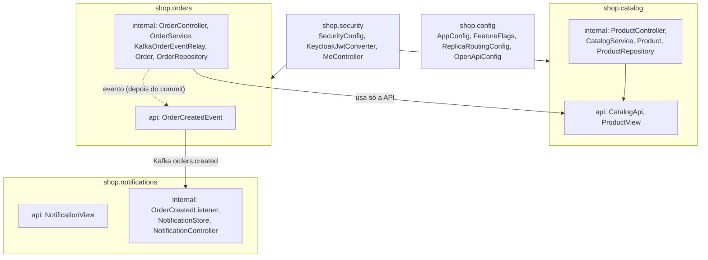

Três regras de arquitetura são vigiadas pelo `ArchitectureTest` (ArchUnit) no CI:

- `orders` não usa `catalog.internal` (fala com o catálogo só por `CatalogApi`).
- `catalog` não usa `orders`.
- `notifications` não conhece `orders` nem `catalog`, só o contrato do Kafka.

### 3.2 Fluxo de um pedido no monólito (sequência)

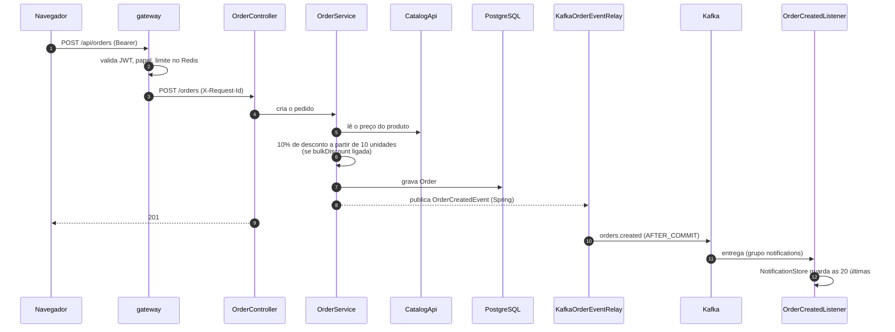

### 3.3 Pacotes e classes do backend

| Pacote | Classe | O que faz |
|---|---|---|
| `shop` | `ShopApplication` | Ponto de entrada Spring Boot |
| `shop.catalog.api` | `CatalogApi`, `ProductView` | Contrato público do catálogo: listar produtos e buscar um por id, e a visão imutável dele |
| `shop.catalog.internal` | `Product`, `ProductRepository` | Entidade JPA e acesso ao banco |
| | `CatalogService` | Implementa `CatalogApi`; guarda a lista e cada produto em cache (`products-list`, `products`) |
| | `ProductController` | `GET /api/products`, `GET /api/products/{id}` |
| `shop.orders.api` | `OrderCreatedEvent` | Evento de domínio "pedido criado" |
| `shop.orders.internal` | `Order`, `OrderRepository`, `OrderResponse` | Entidade, acesso ao banco e resposta da API |
| | `OrderService` | Cria o pedido numa transação: lê o preço no catálogo, aplica o desconto por volume (flag `bulkDiscount`), conta a métrica `shop.orders.created` e publica o evento |
| | `OrderController` | `POST /orders`, `GET /orders`, `GET /admin/summary` |
| | `KafkaOrderEventRelay` | Ouve o evento depois do commit (`AFTER_COMMIT`) e publica em `orders.created`; só existe com `app.events.enabled=true` |
| `shop.notifications.api` | `NotificationView` | Visão de uma notificação |
| `shop.notifications.internal` | `OrderCreatedListener` | `@KafkaListener` de `orders.created` (grupo `notifications`) |
| | `NotificationStore` | Guarda as 20 últimas em memória; a reentrega do mesmo pedido substitui em vez de duplicar |
| | `NotificationController` | `GET /api/notifications` |
| `shop.security` | `SecurityConfig` | Resource server JWT; `/api/admin/**` exige o papel `admin` |
| | `KeycloakJwtConverter` | Converte os papéis do Keycloak (claims do token) em autoridades do Spring |
| | `MeController` | `GET /api/me`: quem o servidor acha que você é |
| | `OpenApiConfig` | Documenta a API (springdoc) |
| `shop.config` | `AppConfig`, `FeatureFlags` | Habilita as flags de funcionalidade (`features.bulk-discount`) |
| | `ReplicaRoutingConfig` | Com `app.datasource.replica-url`, manda transações `readOnly` para a réplica e o resto ao primário |

### 3.4 Gateway

Pacote `com.example.shop.gateway`. Spring Cloud Gateway (WebFlux), em frente aos dois jeitos de implantação.

| Classe | O que faz |
|---|---|
| `GatewayApplication` | Ponto de entrada |
| `GatewaySecurityConfig` | Valida o JWT (assinatura, emissor, audiência, expiração) e autoriza: `/api/admin/**` só `admin`, `/api/**` para `user` ou `admin`, o resto negado; health, Prometheus e OpenAPI liberados |
| `RateLimitConfig` | Chave do limite = usuário do token, ou o IP se não houver; o contador fica no Redis, então vale para todas as réplicas |
| `CorrelationIdFilter` | Garante um `X-Request-Id` em toda requisição, enviado ao serviço e devolvido na resposta |

No perfil do monólito há uma rota, `/api/**`, para o backend. No perfil `microservices` há três: catálogo (produtos, categorias, `/api/me`), pedidos (`/api/orders`, `/api/admin/summary`) e notificações. Todas repetem GET em falha de infraestrutura (até 2 vezes); POST nunca é repetido.

### 3.5 Dados do monólito

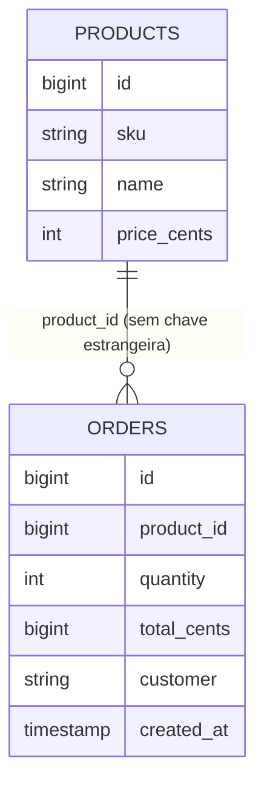

Migrações Flyway: `V1__init`, `V2__seed_products`, `V3__orders_customer`. O banco do monólito é um só; com `app.datasource.replica-url` as leituras vão para uma réplica. O monólito não tem estoque nem categorias: isso só existe nos microsserviços.

---

## 4. Microsserviços

Três serviços de negócio, cada um com seu banco Postgres (`catalog`, `orders`, `notifications`), conversam só por eventos no Kafka. Duas bibliotecas internas ligam tudo: `shop-contracts` (o que é dito) e `shop-common` (como se diz com segurança). Pacote raiz: `com.example.shop`.

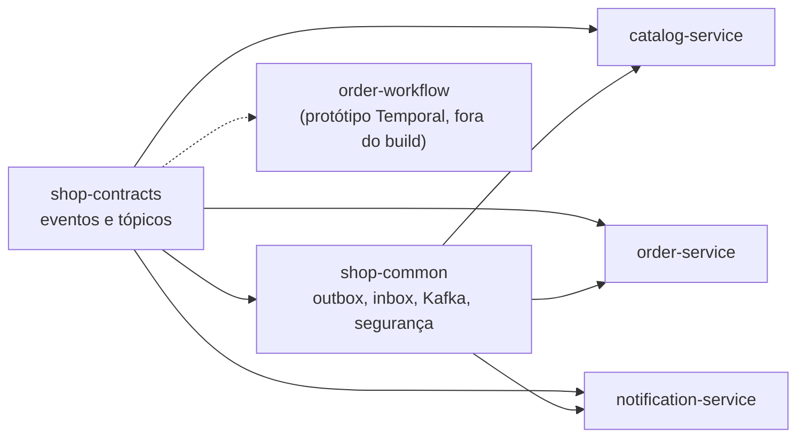

### 4.1 Por dentro de um serviço: o order-service (desenho micro)

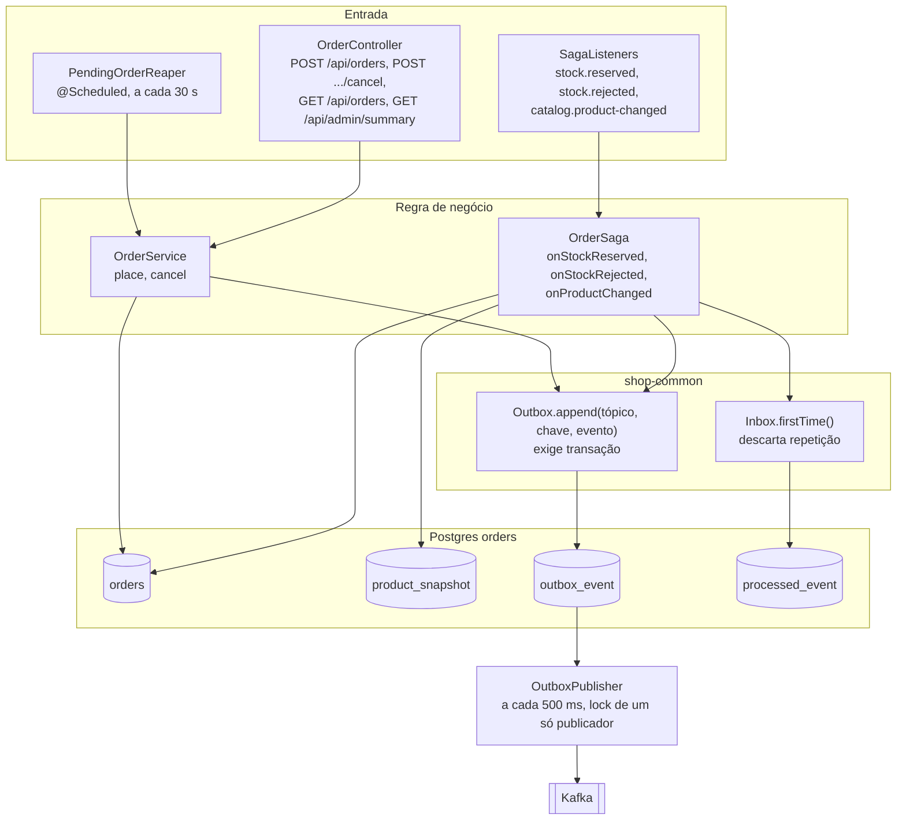

Há três entradas (REST, Kafka e um temporizador) e uma só saída. Toda mudança de estado grava, na mesma transação, a linha do pedido e o evento em `outbox_event`; o `OutboxPublisher` só depois envia ao Kafka. Na volta, o `Inbox` registra o id de cada evento tratado em `processed_event`, então uma reentrega não muda nada. O `catalog-service` tem a mesma forma, com outras regras e o cache Redis; o `notification-service` só consome (usa o inbox e não tem outbox).

### 4.2 Fluxo do pedido: a saga (sequência)

Não há orquestrador: cada serviço reage a um evento e publica o próximo (ADR 0006). O orquestrador Temporal foi avaliado no ADR 0008 e fica como protótipo.

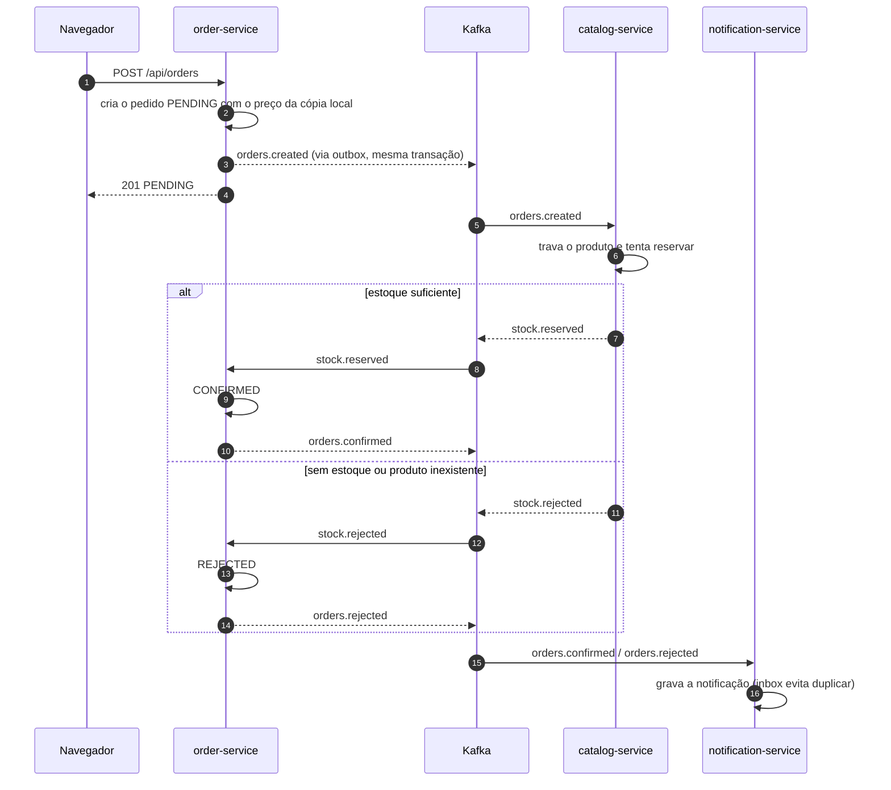

### 4.3 Compensações

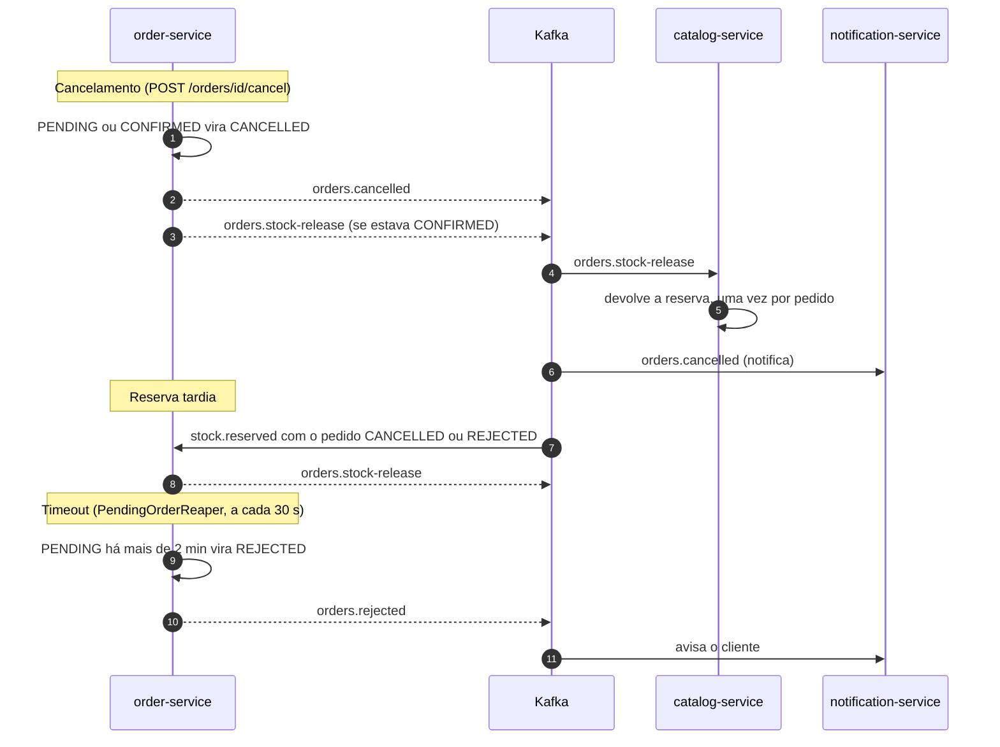

### 4.4 Estados do pedido

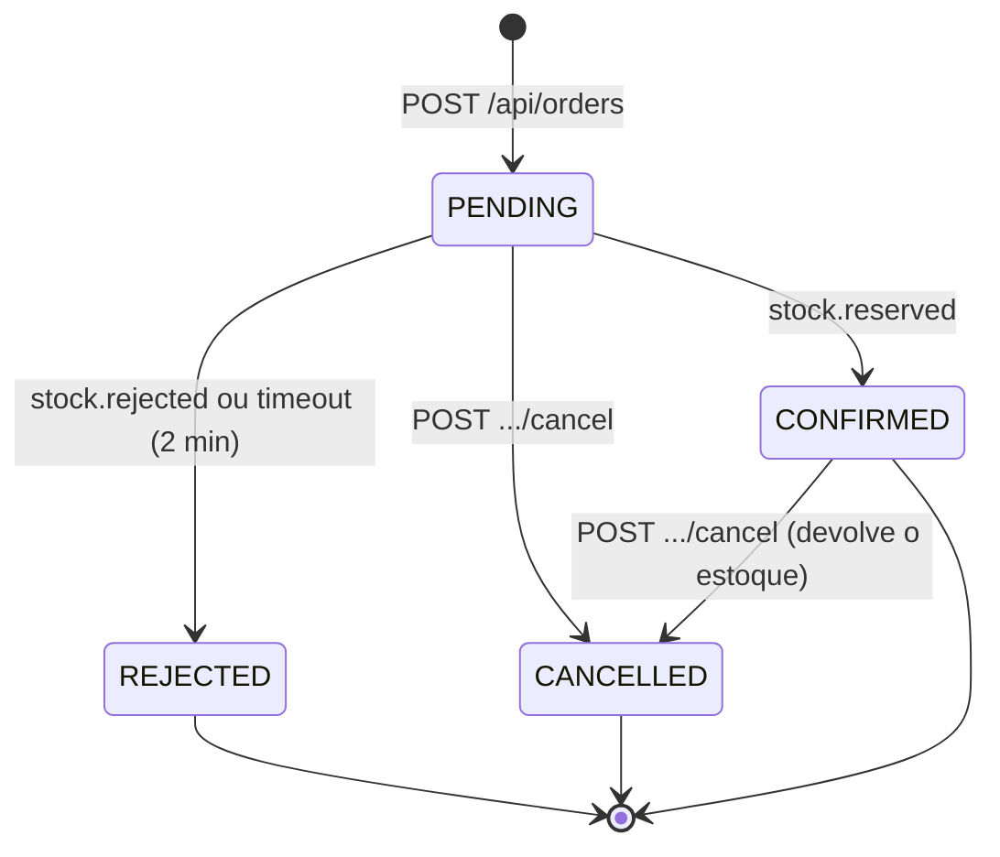

O estado é gravado na linha do pedido, com `version` para bloqueio otimista (conflito vira HTTP 409).

### 4.5 `shop-contracts` (`com.example.shop.contracts`)

| Classe | O que é |
|---|---|
| `DomainEvent` | Interface de todo evento: `eventId` e hora |
| `Topics` | Nomes dos tópicos; cada um tem um único serviço produtor |
| `OrderCreated`, `OrderConfirmed`, `OrderRejected`, `OrderCancelled` | Ciclo de vida do pedido (produtor: order-service) |
| `StockReserved`, `StockRejected` | Resultado da reserva de estoque (produtor: catalog-service) |
| `StockReleaseRequested` | Pedido de devolução do estoque, a compensação (produtor: order-service) |
| `ProductChanged` | Produto criado, alterado (`UPSERTED`) ou removido (`REMOVED`), com `version` crescente (produtor: catalog-service) |

| Tópico | Produtor | Consumidores |
|---|---|---|
| `catalog.product-changed` | catalog-service | order-service (mantém a cópia local do preço) |
| `orders.created` | order-service | catalog-service |
| `stock.reserved` | catalog-service | order-service |
| `stock.rejected` | catalog-service | order-service |
| `orders.confirmed` | order-service | notification-service |
| `orders.rejected` | order-service | notification-service |
| `orders.cancelled` | order-service | notification-service |
| `orders.stock-release` | order-service | catalog-service |

Cada tópico tem também uma fila de falhas `<nome>.DLT` (6 partições). Os testes de contrato (JSON de referência dos eventos) ficam em `shop-contracts`.

### 4.6 `shop-common` (`com.example.shop.common`)

| Pacote | Classe | O que faz |
|---|---|---|
| `common` | `CommonConfig` | Liga o agendamento (`@EnableScheduling`) |
| `common.outbox` | `Outbox` | `append(tópico, chave, evento)`: grava o evento numa tabela; exige transação ativa, então o evento nasce junto do dado |
| | `OutboxEvent`, `OutboxRepository` | Linha da tabela e o acesso a ela |
| | `OutboxPublisher` | A cada 500 ms lê os pendentes e publica no Kafka; um lock consultivo do Postgres garante um único publicador entre réplicas, para manter a ordem por chave |
| | `OutboxCleaner` | Rotina diária que apaga eventos já publicados |
| | `OutboxMetrics` | Métrica `shop.outbox.pending`: eventos ainda não publicados |
| `common.inbox` | `Inbox` | `firstTime(consumidor, eventId)`: falso se o evento já foi tratado, tornando o consumo idempotente |
| | `ProcessedEvent`, `ProcessedEventRepository` | Tabela dos eventos já tratados e sua limpeza |
| `common.kafka` | `KafkaConfig` | Cria os tópicos e suas `.DLT` e define o tratamento de erro: 4 tentativas, depois a fila de falhas |
| `common.persistence` | `AuditableEntity` | Base das entidades editáveis: datas de criação e alteração automáticas e `version` para bloqueio otimista |
| `common.security` | `SecurityConfig`, `KeycloakJwtConverter`, `Identity`, `MeController` | A mesma segurança JWT do monólito para os três serviços; `Identity.isAdmin` testa o papel |

### 4.7 `catalog-service` (`com.example.shop.catalog`)

| Classe | O que faz |
|---|---|
| `CatalogApplication` | Ponto de entrada |
| `Product`, `ProductRepository`, `ProductSpecs` | Entidade, acesso a dados e busca por nome e categoria (com índice trigrama no Postgres) |
| `Category`, `CategoryRepository`, `CategoryService`, `CategoryController` | CRUD de categorias: `/api/categories` e `/api/admin/categories` |
| `CatalogService` | CRUD de produtos paginado; todo create, update e delete grava `ProductChanged` no outbox; limita a busca a 100 caracteres |
| `ProductController` | `/api/products` (leitura) e `/api/admin/products` (cria, altera, apaga) |
| `ProductCache` | Cache Redis de um produto por id (60 s); se o Redis cair, lê do banco |
| `StockService` | Ao receber `orders.created`: trava o produto, reserva e grava `StockReserved`, ou grava `StockRejected` (produto inexistente ou estoque insuficiente). Ao receber `orders.stock-release`: devolve a reserva uma só vez. Invalida o cache após o commit |
| `StockReservation`, `StockReservationRepository` | Uma reserva por pedido, base da idempotência da devolução |
| `OrderCreatedListener` | Consumidor Kafka de `orders.created` e `orders.stock-release` |
| `CatalogAnnouncer` | Ao subir, reanuncia todos os produtos para que um order-service novo se alinhe |
| `ApiErrors`, `ProductNotFound`, `Conflict`, `PageResponse`, `ProductResponse`, `CategoryResponse` | Erros HTTP e formatos de resposta |

### 4.8 `order-service` (`com.example.shop.orders`)

| Classe | O que faz |
|---|---|
| `OrderApplication` | Ponto de entrada |
| `Order`, `OrderStatus`, `OrderRepository`, `OrderResponse` | O pedido e seus estados: `PENDING`, `CONFIRMED`, `REJECTED`, `CANCELLED` |
| `OrderService` | `place`: cria o pedido `PENDING` com o preço da cópia local e grava `OrderCreated` na mesma transação. `cancel`: cancela `PENDING` ou `CONFIRMED` e, se estava confirmado, pede a devolução do estoque |
| `OrderController` | `POST /api/orders`, `POST /api/orders/{id}/cancel`, `GET /api/orders`, `GET /api/admin/summary` |
| `OrderSaga` | Reage a `stock.reserved` (confirma), `stock.rejected` (recusa), `catalog.product-changed` (atualiza o preço local, ignorando versão antiga) e compensa a reserva que chega tarde |
| `SagaListeners` | Consumidores Kafka que chamam a `OrderSaga` |
| `ProductSnapshot`, `ProductSnapshotRepository` | Cópia local de nome, preço e versão do catálogo; pedido de produto sem cópia é recusado |
| `PendingOrderReaper` | A cada 30 s recusa pedidos `PENDING` há mais de 2 minutos e avisa o cliente |
| `OrderMetrics` | Métrica `shop.orders.pending`: crescimento sustentado indica saga travada |
| `ApiErrors`, `OrderNotFound`, `OrderNotCancellable`, `UnknownProduct` | Erros HTTP (409 em conflito de versão otimista) |

### 4.9 `notification-service` (`com.example.shop.notifications`)

| Classe | O que faz |
|---|---|
| `NotificationApplication` | Ponto de entrada |
| `OrderEventListeners` | Consome `orders.confirmed`, `orders.rejected` e `orders.cancelled` |
| `NotificationService` | Grava a notificação usando o inbox (evento repetido não duplica). Não há envio real (e-mail, push, SMS): só se grava a mensagem |
| `Notification`, `NotificationRepository` | Entidade e acesso a dados |
| `NotificationController` | `GET /api/notifications` |

### 4.10 `order-workflow` (protótipo)

`OrderWorkflow`, `OrderWorkflowImpl`, `OrderActivities` e `OrderRequest` desenham o mesmo fluxo como orquestração Temporal. Não está no build e nunca foi compilado, então é só referência (ADR 0008).

### 4.11 Dados dos microsserviços

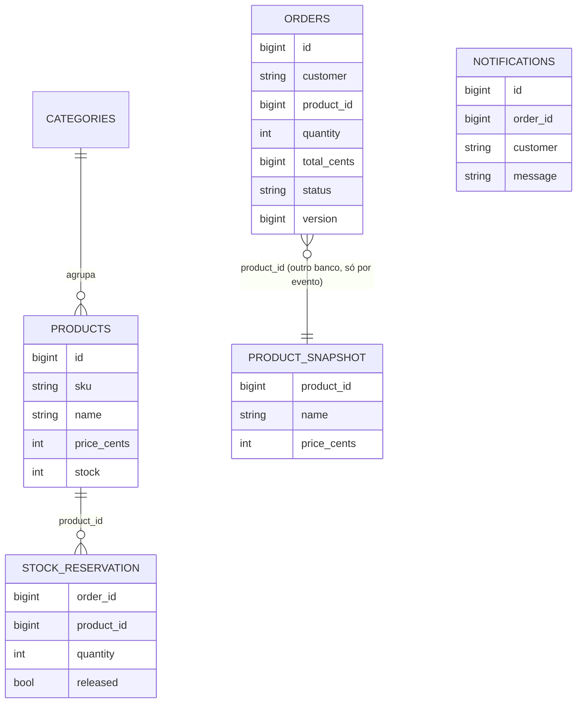

Cada serviço tem o seu banco e, dentro dele, as tabelas `outbox_event` e `processed_event` da biblioteca `shop-common` (migração `V1__outbox_inbox`). Os três bancos são separados: não há consulta nem chave estrangeira entre eles, e o `order-service` só conhece o preço por meio da cópia `product_snapshot`. Migrações por serviço: catálogo `V2` a `V5` (catálogo, categorias e auditoria, reserva de estoque, índice trigrama), pedidos `V2` a `V5` (pedidos, versão, índice de pendentes, versão do catálogo na cópia), notificações `V2`.

---

## 5. Frontends

Há duas interfaces Angular. As duas fazem login no Keycloak com OIDC, código de autorização e PKCE (S256), guardam o token só em memória e o renovam antes de expirar. A versão e o commit aparecem na tela (`data-testid="app-version"`), gerados por `scripts/gen-version.mjs` no build.

### 5.1 `frontend/` (monólito)

| Arquivo | O que faz |
|---|---|
| `main.ts`, `app.config.ts` | Inicia o Angular, registra o `HttpClient` com o interceptor e o login na partida |
| `auth/auth.service.ts` | Login Keycloak (PKCE), usuário, papéis, `isAdmin`, renovação do token |
| `auth/auth.interceptor.ts` | Coloca `Authorization: Bearer` em toda chamada à API |
| `api.service.ts` | Chamadas tipadas: produtos, pedidos, notificações, `me`, resumo do admin, criação de pedido |
| `api/schema.d.ts` | Tipos gerados de `api/openapi.yaml` por `npm run gen:api`; o CI falha se o arquivo divergir do contrato |
| `app.ts`, `app.html` | A tela única: produtos, pedido, pedidos, notificações e painel admin |
| `version.ts` | Versão, commit e hora do build (gerado) |
| `nginx.conf` | Serve o Angular e envia `/api/` ao gateway; `config.json` fica fora do cache |

### 5.2 Shell e microfrontends (`microservices/web/projects`)

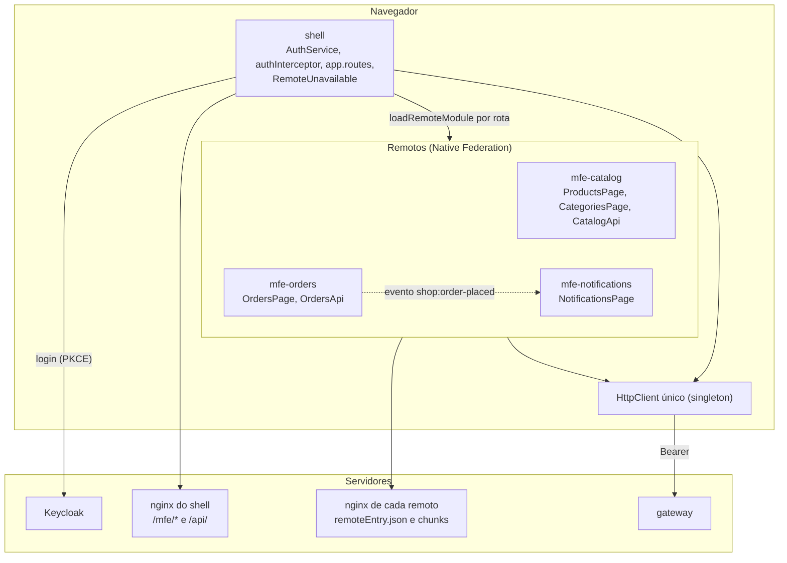

O shell é dono da identidade e da navegação. Cada microfrontend é uma aplicação Angular com deploy próprio, carregada em tempo de execução com Native Federation; os endereços vêm de `federation.manifest.json`, então trocar um remoto não recompila o shell. O shell faz o login uma vez e entrega o token a todos: os remotos não têm login, só reutilizam o `HttpClient` dele. Eles não se chamam entre si; a única ponte é o evento do navegador `shop:order-placed`, que avisa a tela de notificações de um pedido novo.

| Projeto | Arquivos principais | O que faz |
|---|---|---|
| `shell` | `app.routes.ts` | Rotas `catalog`, `orders`, `notifications`, cada uma carregada por `loadRemoteModule(nome, './routes')`; se o remoto cair, mostra `RemoteUnavailable` em vez de quebrar |
| | `auth/auth.service.ts`, `auth/auth.interceptor.ts` | Login e token; os remotos reaproveitam o mesmo `HttpClient` |
| | `app.ts`, `remote-unavailable.ts`, `version.ts` | Moldura de navegação, aviso de remoto fora do ar e versão |
| `mfe-catalog` | `products.page.ts`, `categories.page.ts`, `catalog-nav.ts` | Lista paginada com busca no servidor; o admin cria, edita e apaga produtos e categorias |
| | `catalog.api.ts`, `errors.ts`, `format.ts` | Chamadas ao catálogo, mensagens de erro (`messageFor`) e pipes de moeda (`BrlPipe`) e data (`StampPipe`) |
| `mfe-orders` | `orders.page.ts`, `orders.api.ts` | Faz, lista e cancela pedidos; ao fazer um, dispara `shop:order-placed` |
| `mfe-notifications` | `notifications.page.ts` | Lista as notificações e recarrega ao ouvir `shop:order-placed` |

Cada microfrontend tem `bootstrap.ts` e `main.ts` (para rodar isolado em desenvolvimento, sem login), `app.config.ts` e `federation.config.js`, que expõe só `./routes`. As dependências Angular são compartilhadas como singleton.

| Servidor | Papel |
|---|---|
| `nginx.shell.conf` | O shell serve a si mesmo, envia `/api/` ao gateway e repassa `/mfe/catalog/`, `/mfe/orders/` e `/mfe/notifications/` a cada microfrontend |
| `nginx.remote.conf` | Serve cada microfrontend (`remoteEntry.json` e chunks) |
| `scripts/federation-smoke.mjs` | Confere o manifesto, as exposições e a versão em Chromium |

---

## 6. Implantação e segurança

| Item | Detalhe |
|---|---|
| `docker-compose.yml` | Monólito: frontend, gateway, backend, `postgres` e `postgres-replica`, Keycloak, Redis, Kafka, SonarQube e a pilha de observabilidade (Prometheus, Alertmanager, Tempo, Loki, Promtail, Grafana) |
| `microservices/docker-compose.yml` | Microsserviços: `edge` (nginx com HTTPS), shell e três microfrontends, gateway, três serviços, Postgres com um banco por serviço, Keycloak, Redis e Kafka; certificados locais de `infra/tls/gen-certs.sh` |
| `microservices/docker-compose.vm.yml` | VM com domínio público: Caddy com certificado Let's Encrypt, gerado por `infra/vm/render.sh` |
| `k8s/` | Kustomize do monólito: `base` (backend, gateway, frontend, `hpa.yaml`, `pdb.yaml`, canário) e overlays `staging` e `production` |
| `microservices/k8s/` | Kustomize dos microsserviços: um manifesto por componente (gateway, três serviços, shell e três microfrontends), com escalonamento automático e disruption budget, mais `networkpolicy.yaml`, `ingress.yaml` e `canary-services.yaml`. Overlays `staging`, `production` e `production-secure` |
| Extras opcionais | TLS interno (Linkerd), External Secrets, cert-manager, KEDA e Karpenter. Nunca aplicados em cluster real |
| Autenticação | Keycloak 26 emite o JWT (papéis `user` e `admin`, realm em `infra/keycloak/shop-realm.json`); o gateway valida assinatura, emissor, audiência e expiração, e cada serviço valida de novo |
| Limite de uso | Por usuário (ou IP), no Redis, no gateway |
| Rastreio | `X-Request-Id` em toda requisição; traces no Tempo, logs no Loki, métricas no Prometheus |
| Alertas | `observability/rules` (SLO e serviços) no Alertmanager; painéis Grafana `shop` e `services` |
| Segredos | Em Kubernetes vêm de `secret.example.yaml` (modelo) ou External Secrets; o job de release só faz deploy se `KUBE_CONFIG_STAGING`/`KUBE_CONFIG` existirem |

---

## 7. Automação: CI, release e testes

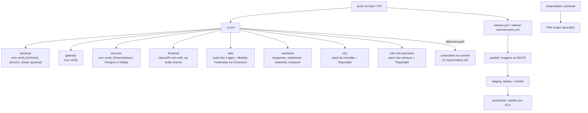

Os jobs rodam em paralelo; os dois `e2e` não esperam os testes unitários. O `ci.yml` cancela a rodada anterior de um PR quando chega um push novo e dá 30 minutos a cada job. Há cache de Maven e npm (pelo `setup-java` e `setup-node`), do Chromium do Playwright e do binário do actionlint.

| Camada | Testes | Onde rodam |
|---|---|---|
| Backend | `ArchitectureTest` (fronteiras), `SecurityTest` e `KeycloakJwtConverterTest` (401, 403, papéis), `OrderFlowTest`, `OrderServiceTest`, `BulkDiscountFlagTest`, `ContractTest`, `PostgresMigrationTest`, `OrderCreatedListenerTest`, `KafkaOrderEventRelayTest` | job `backend` |
| Gateway | 2 testes de classe | job `gateway` |
| Serviços | Unitários (`OrderSagaTest`, JSON de referência de `ProductChanged`, outbox) e ITs com Testcontainers (Postgres e Kafka reais): `OrderFlowIT` (timeout, cancelamento, reserva tardia, lock do publicador) e `CatalogFlowIT` | job `services` |
| Angular | Karma/Jasmine do monólito e dos microfrontends, e `federation-smoke.mjs` | jobs `frontend` e `web` |
| Manifestos | Kustomize renderizado para staging, production e production-secure, mais o compose da VM, shellcheck e actionlint | job `manifests` |
| Ponta a ponta | Playwright com a pilha inteira no Docker: login no Keycloak, 401 e 403 pelo gateway, pedido e notificação via Kafka (monólito); catálogo paginado, CRUD de admin, pedido confirmado pela saga e cancelado (microsserviços) | jobs `e2e` e `e2e-microservices` |

Scripts: `deploy.sh`, `deploy-microservices.sh`, `canary.sh`, `canary-service.sh`, `smoke.sh`, `elasticity-check.sh`, `protect-main.sh`, `ci-report-failure.sh`. Decisões em `docs/adr` (8 ADRs), SLOs em `docs/slo.md`, dívida em `docs/DIVIDA-TECNICA.md`.

---

## 8. Terceiros

| Terceiro | Onde entra | Obrigatório? |
|---|---|---|
| Spring Boot 3.5 (Web, Data JPA, Security, Kafka, Actuator), Flyway | Backend, serviços | sim |
| Spring Cloud Gateway (WebFlux) | Gateway | sim |
| Angular, keycloak-js, Native Federation | Frontends | sim |
| Keycloak 26 | Login OIDC e JWT | sim |
| PostgreSQL 16 | Dados (monólito: um banco; serviços: um por serviço) | sim |
| Redis 7 | Limite do gateway; cache do catálogo | sim |
| Kafka 3.9 (KRaft) | Eventos; único canal entre os microsserviços | sim |
| nginx | Serve os Angular e faz proxy; `edge` com HTTPS nos microsserviços | sim |
| Caddy | HTTPS público na VM (Let's Encrypt) | só na VM |
| Prometheus, Alertmanager, Tempo, Loki, Promtail, Grafana | Métricas, alertas, traces, logs, painéis | operação |
| SonarQube | Análise estática do monólito; o job só roda com o segredo | opcional |
| Testcontainers, ArchUnit, JaCoCo | Testes e cobertura | desenvolvimento |
| Playwright, Karma/Jasmine | Testes de navegador e de unidade do front | desenvolvimento |
| Temporal SDK | Protótipo `order-workflow` | não (fora do build) |
| GitHub Actions, GHCR, Dependabot | CI, release e atualização de dependências | desenvolvimento |

---

## 9. Limites deste documento

- O CI do GitHub Actions é o único lugar onde Maven, Docker e os navegadores rodam; os testes acima passaram ali no último commit da `main` conferido.
- **Não foi executado em ambiente real:** Kubernetes, Linkerd, External Secrets, cert-manager, canário contra Prometheus real, a VM com Caddy e Let's Encrypt, o protótipo Temporal (nunca compilado) e a métrica de lag do Kafka. O detalhe de cada dívida está em `docs/DIVIDA-TECNICA.md`.
- A réplica de leitura do Postgres existe no compose do monólito; o roteamento `readOnly` só vale com `app.datasource.replica-url`.
- Os tipos das colunas e os nomes de campo nos diagramas de dados são resumidos: a fonte é a pasta `db/migration` de cada módulo.
- O `notification-service` só grava a mensagem; não há envio de e-mail, push ou SMS.
- Este documento não é gerado automaticamente: se uma classe nascer, mudar de pacote ou sair, ele precisa de atualização manual.
