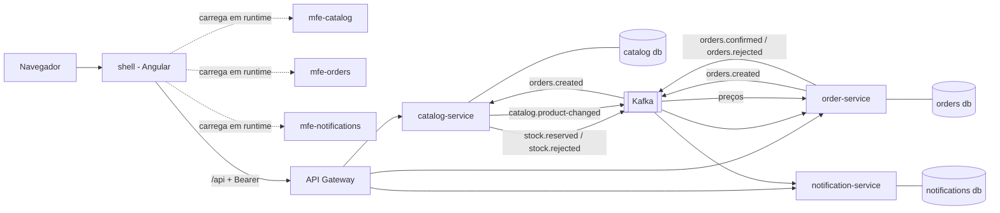

# Versão microsserviços + microfrontends

> **Como executar tudo, em ordem:** [../docs/PASSO-A-PASSO.md](../docs/PASSO-A-PASSO.md)

Alternativa ao monólito modular da raiz. Mesma loja, mesmo Keycloak, mesmo gateway e mesma observabilidade, agora com serviços e telas independentes. Decisão e trade-offs: `docs/adr/0005-microsservicos-e-microfrontends.md`.



## Fluxo de um pedido (saga coreografada)
1. `POST /api/orders` no order-service: grava o pedido `PENDING` e, **na mesma transação**, o evento `orders.created` no outbox. Responde 202.
2. O relay do outbox publica no Kafka. O catalog-service consome, trava a linha do produto, baixa o estoque e grava `stock.reserved` (ou `stock.rejected`) no seu outbox.
3. O order-service consome a resposta e marca o pedido `CONFIRMED` (ou `REJECTED`), gravando `orders.confirmed` (ou `orders.rejected`).
4. O notification-service consome e cria a notificação do cliente. A tela de pedidos atualiza sozinha enquanto houver pedido `PENDING`.

**Compensações (sem orquestrador):**
- **Timeout:** um pedido `PENDING` por mais de `ORDER_PENDING_TIMEOUT` (padrão 2 min) é recusado pelo `PendingOrderReaper` (`for update skip locked`, seguro com várias réplicas).
- **Cancelamento:** `POST /api/orders/{id}/cancel` (dono ou admin). Um pedido `CONFIRMED` emite `orders.stock-release`; o catálogo devolve o estoque **uma única vez** por pedido (tabela `stock_reservation`).
- **Reserva tardia:** se `stock.reserved` chegar para um pedido já `CANCELLED`/`REJECTED`, o order-service pede a liberação na hora.
- Os produtos usam **um único tópico** `catalog.product-changed` (chave = id do produto, tipo `UPSERTED`/`REMOVED`), então a ordem por produto é garantida.

## Catálogo: paginação, busca e cache
`GET /api/products?q=&categoryId=&page=&size=&sort=` devolve `{items,total,page,size}` (size 1..100; ordena por `id,name,priceCents,stock`). `GET /api/products/{id}` usa **Redis** como cache opcional (`REDIS_HOST`, `PRODUCT_CACHE_TTL`, padrão 60 s): se o Redis cair, a leitura cai para o banco; a invalidação roda depois do commit.

## Contratos e OpenAPI
- `shop-contracts` tem testes de contrato com arquivos JSON de referência (`src/test/resources/contracts/*.json`): o produtor precisa gerar exatamente o JSON, e o consumidor precisa ler o JSON (leitor tolerante a campos novos). Mudou um evento de propósito? Atualize o arquivo no mesmo PR.
- Cada serviço publica `/v3/api-docs` (e `/swagger-ui.html` com `SWAGGER_UI=true`).

## Observabilidade por serviço
`observability/rules/services.yml` (SLI por `service`, queima de orçamento, p99, backlog do outbox, DLT, lag do consumidor, pedidos presos) e o painel Grafana **Shop - Servicos**. Métricas novas: `shop_outbox_pending`, `shop_dlt_messages_total{topic}`, `shop_orders_pending`.

## Segurança interna e segredos (Kubernetes)
- **mTLS entre pods:** Linkerd (`namespace.yaml` já tem `linkerd.io/inject: enabled`).
- **TLS interno Kafka/Postgres:** componente `k8s/optional/internal-tls` (exige o lado servidor configurado fora deste projeto).
- **External Secrets:** `k8s/optional/external-secrets`. O overlay `production-secure` junta os dois.

## Canário por serviço
`scripts/canary-service.sh <catalog|order|notification> <imagem>` sobe réplicas `track: canary` em 10/25/50 %, consulta o SLO do serviço no Prometheus e reverte se falhar (sem dados = falha). A divisão é por proporção de réplicas, não por cabeçalho.

## Rodar em uma VM com domínio e certificado automático
`DOMAIN=... ACME_EMAIL=... microservices/infra/vm/render.sh` e depois `docker compose -f docker-compose.yml -f docker-compose.vm.yml --env-file infra/vm/generated/.env up -d`. O Caddy obtém o certificado Let's Encrypt; só as portas 80/443 ficam públicas.

## Testes de integração (Postgres e Kafka reais)
`order-service/.../OrderFlowIT` e `catalog-service/.../CatalogFlowIT` (Testcontainers, rodam em `mvn verify` pelo failsafe; pulados sem Docker): reaper com transação real, cancelamento e reserva tardia, lock de publicação do outbox, busca paginada no Postgres e devolução de estoque uma única vez. **Escritos, nunca executados.**

## Teste ponta a ponta
`e2e/playwright.ms.config.ts` (Chromium contra `https://localhost:8443`): login, busca/paginação, CRUD de admin, pedido → confirmado → cancelado. Job `e2e-microservices` no CI.

Se o Kafka cair no meio, os eventos esperam no outbox. Se um evento for entregue duas vezes, o inbox o ignora. Se uma mensagem for inválida, vai para `<tópico>.DLT` depois de 4 tentativas.

## Modelo de dados e CRUD (catalog-service)
Entidades JPA/Hibernate do catálogo, todas com `createdAt`, `updatedAt` e `version` (`AuditableEntity`):

| Entidade | Relação | Recursos do Hibernate usados |
|---|---|---|
| `Category` | 1 categoria : N produtos | `@Version` (bloqueio otimista), nome único |
| `Product` | N:1 com `Category` (`LAZY`) | `@Version`, exclusão lógica (`@SQLDelete` + `@SQLRestriction`), `JOIN FETCH` na listagem (evita N+1), lock pessimista só na reserva de estoque |
| `Order` (order-service) | referencia o produto por id, sem FK entre bancos | `@Version`, enum `@Enumerated(STRING)` |
| `ProductSnapshot` (order-service) | cópia local de preço | upsert por evento |

Endpoints (leitura para qualquer usuário; escrita só admin):
`GET/POST/PUT/DELETE /api/products` (`/api/admin/products` para escrita) e `GET /api/categories`, `POST/PUT/DELETE /api/admin/categories`.
- `PUT` leva a `version` que a pessoa viu na tela. Se outra pessoa salvou antes, a resposta é **409** e a tela avisa e recarrega.
- `DELETE` de produto é lógico: pedidos antigos continuam válidos, e o evento `catalog.product-changed` (tipo `REMOVED`) faz o order-service parar de aceitar pedidos dele.
- `DELETE` de categoria com produtos devolve **409**.

No frontend (`mfe-catalog`): abas Produtos e Categorias, busca e filtro, formulário de criar/editar, exclusão com confirmação em duas etapas, mensagens de erro do servidor. Usuário comum vê só a leitura.

## Pastas
| Pasta | O que é |
|---|---|
| `services/shop-contracts` | records dos eventos e nomes dos tópicos (sem dependências) |
| `services/shop-common` | outbox, inbox, JWT/Keycloak, tópicos, DLT, configuração comum |
| `services/{catalog,order,notification}-service` | os três serviços |
| `web/` | workspace Angular: `shell` + 3 microfrontends (ver `web/README.md`) |
| `k8s/` | kustomize por serviço: Deployment, Service, HPA, PDB; overlays staging e production |
| `docker-compose.yml` | tudo local, com um Postgres com 3 bancos |

## Rodar
```bash
docker compose -f microservices/docker-compose.yml up --build
# app http://localhost:4200  |  API http://localhost:8080  |  Keycloak :8180  |  Grafana :3000
```

## Status de verificação
- **Executado de verdade:** build dos 4 apps Angular e 20 verificações em Chromium headless: Module Federation (shell carrega os 3 remotos de outra origem, token em todas as chamadas, remoto fora do ar não derruba o shell) e o CRUD de produtos e categorias (criar, editar com versão, conflito, excluir com confirmação) contra uma API simulada; `kustomize build` dos overlays; `docker compose config`; `actionlint`; sintaxe Java varrida pelo `javac` (sem erros de sintaxe) e o módulo `shop-contracts` compilado.
- **Executado no CI do GitHub (commit `b62b144`, 8 de 8 jobs verdes):** `mvn verify` dos três serviços (testes unitários, de contrato e de integração com Postgres e Kafka reais), a stack inteira do compose (Postgres, Kafka, Keycloak, 3 serviços, gateway, shell e microfrontends, Redis, Tempo, Grafana) e o e2e no Chromium: login no Keycloak, catálogo com busca e paginação, CRUD de admin, pedido confirmado pela saga e cancelado.
- **Ainda não executado:** Kubernetes de verdade (só `kustomize build`), Linkerd, External Secrets, cert-manager, canário contra um Prometheus real, VM com Caddy e certificado público, o protótipo `order-workflow` (Temporal) e o nome da métrica de lag do Kafka.
- **Também executado de verdade:** a lógica dos arquivos de contrato com o Jackson real, `kustomize build` (incluindo `production-secure`), `docker compose config` do compose da VM, scripts de canário/deploy com `kubectl` e `curl` falsos, `shellcheck`, `actionlint`.
- **Não incluído:** réplica de leitura do Postgres (roteamento), Pact (usamos arquivos JSON de referência), checagem de drift do OpenAPI por serviço no CI, orquestrador de saga.


## HTTPS e certificado digital

Toda entrada do usuario e HTTPS (TLS 1.2 e 1.3, HSTS de 1 ano). O que muda por ambiente:

| Ambiente | Quem termina o TLS | Certificado |
|---|---|---|
| Docker Compose | servico `edge` (nginx) em `https://localhost:8443` (app) e `:8444` (Keycloak) | CA local + certificado ECDSA gerados por `infra/tls/gen-certs.sh` (SAN: localhost, 127.0.0.1) |
| Kubernetes | Ingress nginx, com `force-ssl-redirect` e HSTS | cert-manager + Let's Encrypt (`k8s/cert-manager/cluster-issuers.yaml`); staging usa o emissor de teste, producao o real; renovacao automatica |

Compose: rode `infra/tls/gen-certs.sh`, importe `infra/tls/certs/ca.crt` no navegador (ou use mkcert) e abra
`https://localhost:8443`. Gateway e Keycloak deixam de publicar portas em HTTP; `http://localhost:8000` redireciona (301).
O issuer do JWT passa a ser `https://localhost:8444/realms/shop`.

Kubernetes: instale o cert-manager, aplique `cluster-issuers.yaml` (troque o e-mail) e ajuste o dominio no Ingress.

**Verificado:** a CA e o certificado foram gerados e validados com `openssl verify` (SAN e `serverAuth` conferidos);
um servidor TLS de teste com esse certificado respondeu 200 com a CA, foi recusado sem ela e recusou TLS 1.1;
`kustomize build` dos 4 overlays mostra emissor e redirecionamento corretos; `docker compose config` valido.
**Nao verificado:** o nginx `edge` no ar (sem Docker aqui), o login no Keycloak por HTTPS, a emissao real pelo
Let's Encrypt (precisa de dominio publico).
**Limite:** o trafego interno (pod a pod, servico a banco, Kafka) segue em HTTP/plaintext dentro da rede do
cluster. Para TLS interno com mTLS seria preciso uma malha de servico (Linkerd/Istio) e TLS no Kafka e Postgres.


## Auditoria arquitetural: o que foi corrigido

Revisao cruzando codigo, manifestos, CI e documentacao. Itens corrigidos:

| Achado | Risco | Correcao |
|---|---|---|
| Topicos `.DLT` nao eram declarados e o recoverer publica na MESMA particao do original | mensagem com falha em particao 1+ nao chegava a DLT (broker cria com 1 particao) e se perdia | `KafkaConfig` cria cada `.DLT` com as mesmas particoes |
| Topicos com 3 particoes, HPA ate 6 replicas | replicas 4 a 6 ficariam ociosas no consumo Kafka (maximo de consumidores = particoes) | `PARTITIONS = 6`, igual ao `maxReplicas`; mude os dois juntos |
| `protect-main.sh` exigia 5 checks e ignorava `services` e `web` | codigo dos microsservicos e microfrontends podia entrar na main sem CI verde | contexts agora incluem `services` e `web` |
| PodMonitor so cobria `backend` e `gateway` | microsservicos sem metricas (e sem alertas de SLO) em Kubernetes | `k8s/observability/podmonitor.yaml` para os 4 apps |
| Nenhuma NetworkPolicy | qualquer pod chegava direto aos servicos, pulando o gateway | `networkpolicy.yaml`: nega entrada por padrao e libera so ingress, shell, gateway e Prometheus |
| Nao havia release para as imagens dos microsservicos | o desenho prometia "uma imagem por servico", mas so o monolito era publicado | `release-microservices.yml` + `scripts/deploy-microservices.sh` (manual, ver abaixo) |
| Header `Host` da borda usava a porta interna (443) | URLs geradas com porta errada atras do nginx | usa `$http_host` |

Trade-offs deixados em aberto, de proposito:
- **Release manual:** monolito e microsservicos usam os mesmos namespaces e nomes; automatizar os dois no mesmo cluster
  faria um sobrescrever o outro. Escolha uma arquitetura por cluster.
- **Canario por servico:** feito por proporcao de replicas (nao por cabecalho); o gateway fica de fora.
- **Ordem entre topicos:** resolvida com o topico unico `catalog.product-changed` (chave = id do produto).
- **Nenhum Java foi compilado:** Maven Central e inacessivel neste ambiente; os testes seguem sem execucao.
